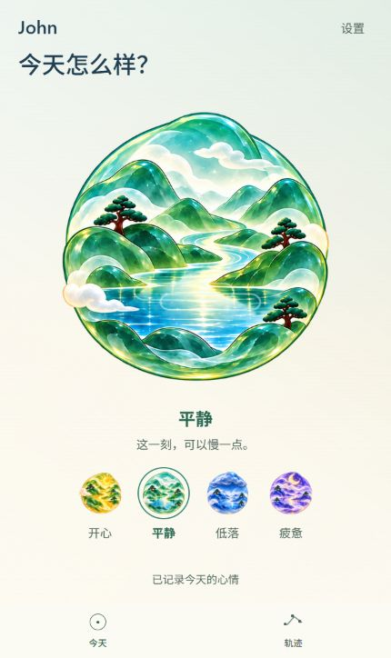
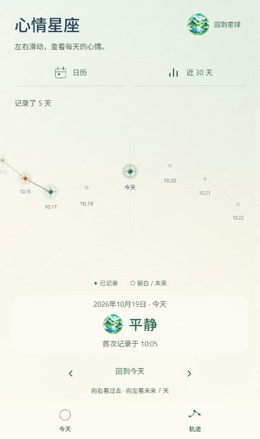
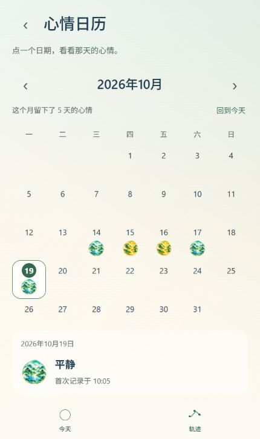
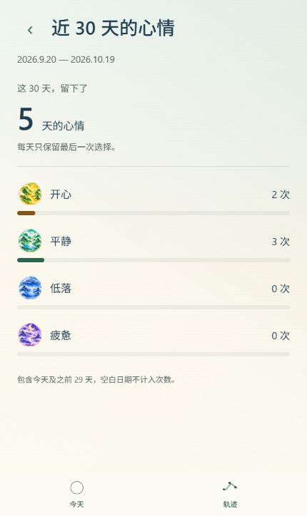

# 3B：四页美术与陪伴文案

2026-10-19。代码与电脑端检查完成，美术效果待用户体验。本轮集中统一今天、轨迹、日历和统计的琉璃主题；未开始 3C 的其他页面空间衔接、设置功能和 Android 真机验收。

## 体验与画面

[打开正式 App](http://localhost:8081/)。设置中可选择琉璃星球或原宇宙玻璃舱；本轮保留用户已保存的主题。正式预览当前为 John、平静、5 天记录，首次记录时间仍为 10:05。以下为本轮正式预览的完整 App 画面：

四页使用同一片浅绿、暖米色光场，随当天心情轻微着色，星球素材和天气动效保持原样。日历、统计此前已支持琉璃图标，本轮复用并放大，没有再创建一套图标组件。

星座仍是星星连线，增强已记录节点、日期和选中详情的辨识度，空白与未来星位仍留白；旧心情在详情中明确标注“旧记录”。日历区分今天与选中日期，底部详情使用轻薄的半透明背景。统计突出真实记录天数与次数，色带仍以 30 天为分母；无记录时只显示空状态与开始提示，避免重复强调“0 天”。

首页短句分别为：开心“把这一刻的好心情留住。”、平静“这一刻，可以慢一点。”、低落“不用急着让自己开心。”、疲惫“累了，就在这里歇一会儿。”。短句不代表保存成功；原有正在保存、已记录、失败重试等状态继续独立显示。未记录时显示“此刻的感受，选一个就好。”，不默认选择某种心情。

## 修改文件与理由

| 文件 | 修改与理由 |
| --- | --- |
| `src/components/liuli/LiuliBackdrop.tsx`、`src/navigation/SpaceScene.tsx` | 增加共享的浅色渐变光场，四页不再各自铺平色；保留原镜头路径和玻璃舱背景。 |
| `src/theme/appThemes.ts` | 加深浅色背景上的次要文字、操作色与心情文字色，保留素材本身的色彩。 |
| `src/components/liuli/LiuliArt.tsx` | 增加正式页使用的陪伴短句；原样板的天气说明保留，四种心情类型和素材取景不变。 |
| `src/components/liuli/LiuliMoodButton.tsx`、`src/screens/LiuliTodayScreen.tsx` | 选择文字与首页文案使用可读性更好的配色，保持原软胶反馈、选择和保存逻辑。 |
| `src/components/ConstellationTrail.tsx` | 记录节点增加琉璃高光，增强连线与日期；选中详情复用现有心情图标，并标注旧记录。 |
| `src/screens/CalendarScreen.tsx` | 放大琉璃图标、日期和月份，区分今天与选中日期，统一固定详情的材质与字号。 |
| `src/screens/StatisticsScreen.tsx` | 调整记录天数、图标、次数和色条层级，减少空状态重复提示；统计公式不变。 |
| `README.md`、本目录、`docs/space-pullback/README.md` | 更新当前阶段、截图与验收记录。 |

没有新增依赖、图片素材、心情类型或存储字段。昵称修改、标签、AI、导出等不在本轮范围。

## 验收结果与边界

- 类型检查、全部 70 项现有回归测试通过。样式和文案没有新增只复述数值的测试，实际显示通过浏览器检查。
- 最终 Web、Android JavaScript 导出成功，分别位于 `.codex-tmp/art-stage-3b-web`、`.codex-tmp/art-stage-3b-android`。没有生成 APK。
- 两主题 × 四页 × 三种尺寸（320 × 640、430 × 680、360 × 800）共 24 组布局检查通过：无横向溢出，底部两个入口正确，固定返回、详情和首页操作区在底栏上方。日历月底与统计最后一行可滚动查看。
- 隔离记录环境依次选择四种心情：首页短句、轨迹、日历和统计一致，记录始终为 4 天，首次创建时间保持 10:03；切换到疲惫时统计为 2 次，恢复平静后为 1 次，未重复新增日期。
- 普通、充满动力的旧记录继续显示和计数；轨迹与日历明确显示旧记录标签。未来日期显示尚未到来，不生成心情。
- 独立空记录环境显示未记录首页、空白星位和无记录统计；最终空状态没有重复的“0 天”大数字和虚假条目。
- 以底色端点叠加各心情色最大透明度、忽略提高亮度的白光层计算配色候选：正文最小 8.97:1、次要文字 4.73:1、操作色 5.04:1，心情文字色均超过 4.5:1。这是基于配色的计算，不代表所有动态透明度和实际设备字体已完成无障碍验收。
- 正式预览已刷新，四页均使用原有 5 天记录，平静及首次记录时间不变；正式与隔离记录预览采集的浏览器警告、错误为空。

隔离验证分别使用 `127.0.0.1:8082` 的历史记录和 `127.0.0.1:8083` 的空记录，未向正式预览写入测试心情。原始证据位于 `.codex-tmp/art-stage-3b-qa`：`responsive.json`、`mood-flow.json`、`legacy-trail.json`、`legacy-and-scroll.json`、`empty-final.json`、`contrast.json`、`formal.json`、运行日志及各尺寸截图。

尚未验证：Android 原生存储、实体返回键、设备帧率与手势、系统大字号、减少动态和安全区的设备表现。美术满意度与真实日常使用感仍待用户体验。

## Plan 状态

1. 已完成：核对现有图标、配色与层级，复用原组件。
2. 已完成：四页背景、图标尺寸、日期与计数层级、首页陪伴文案。
3. 已完成：数据联动、两主题三尺寸、空记录与旧记录检查，双端导出、截图和说明。
4. 待用户验收：整体美术与文案感受。
5. 未开始：3C 其余页面衔接、设置细节与后续 Android 真机验收。
