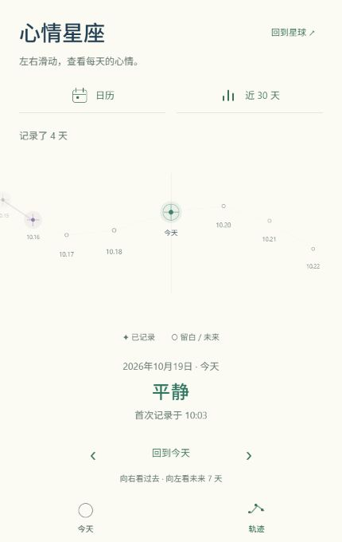
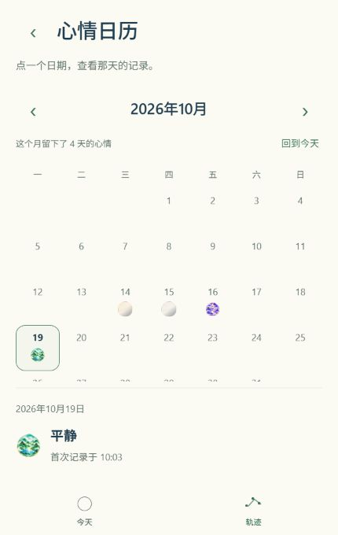
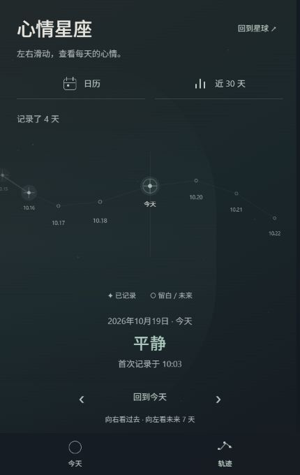

# 阶段二：今天与轨迹

后续更新（2026-10-19）：[阶段 3A 空间转场样板](../space-stage-3a/README.md) 已完成代码与电脑端检查，镜头设计待用户体验。以下保留阶段二的导航范围与验收记录。

2026-10-19。代码与电脑端验收已完成，用户体验验收待进行。本阶段只调整入口和返回关系；新的页面美术与空间镜头留在下一阶段。

## 预览与使用

[打开正式 App](http://localhost:8081/)。若服务停止，在项目目录运行 `npm.cmd run web -- --localhost --port 8081`。

- 底部始终只有“今天 / 轨迹”两个主入口。
- “轨迹”显示原有心情星座，顶部的“日历 / 近 30 天”进入对应查看页。
- 日历与统计页的左上角有固定的“返回轨迹”，滚动内容时不会一起移走；两页底部均选中“轨迹”。点击底部轨迹也回到星座根页。
- 日历保留已浏览月份，返回轨迹再进入时无需重新翻月；星座原有日期浏览状态继续保留。
- Android 返回处理为“日历或统计 → 轨迹 → 今天”；在今天页且没有转场时，交由系统处理。转场中按返回不会直接退出。这部分逻辑已有测试，实体按键待真机确认。

以下截图来自独立验收预览，使用测试昵称和记录，尺寸为 430 × 680：

## 修改文件及理由

| 文件 | 修改与理由 |
| --- | --- |
| `src/navigation/appNavigation.ts` | 集中两主入口、所属区域及返回目标，避免不同页面各自推断返回历史。 |
| `src/navigation/MainTabBar.tsx` | 显示两个主入口，包含安全区、选中语义和触摸区域；沿用原有转场事件与连续点击队列。 |
| `src/navigation/AppNavigator.tsx` | 接入新底栏，关闭旧的标签历史返回；保留四条内部路由与原镜头连接，不引入新依赖。 |
| `src/navigation/SpacePage.tsx` | Android 返回使用明确父级关系，避免从今天意外回到旧日历或统计。 |
| `src/components/RecordsSubpageHeader.tsx` | 日历与统计共用固定返回入口，保持行为与标题一致。 |
| `src/screens/RecordsScreen.tsx` | 在星座上方增加日历与近 30 天入口，保留原星座和记录逻辑。 |
| `src/screens/CalendarScreen.tsx`、`src/screens/StatisticsScreen.tsx` | 将标题与返回放在滚动区域外，调整间距；日期与统计算法不变。 |
| `src/navigation/appNavigation.test.cjs` | 新增 6 项父级返回、路由身份与旧标签历史回归测试。 |
| `README.md`、本目录、`docs/theme-stage-one/README.md` | 更新当前使用方式，保留阶段一历史验收记录。 |

采用两个可见主入口、四条内部路由，而非增加一层导航框架。这样能保留原来的共享星球、转场队列和日历状态；层级通过固定返回与主入口归属表达。

没有新增依赖、存储字段或数据迁移。主题选择、昵称与心情记录继续使用原存储；本轮测试记录写在独立的 `127.0.0.1:8082` 来源，未用测试记录替换正式预览数据。

## 验收结果与边界

- 类型检查通过；原有 60 项与新增 6 项回归测试全部通过，共 66 项。
- Web 与 Android JavaScript 导出成功，分别位于 `.codex-tmp/navigation-stage-two-web` 和 `.codex-tmp/navigation-stage-two-android`。未生成 APK。
- 两主题实际检查今天、轨迹、日历与统计的进入、返回；子页选中轨迹，点击轨迹打开星座根页。从子页回到今天、再进轨迹不会重开子页。
- 宇宙玻璃舱快速连续点选主入口、从日历连续切回今天与轨迹，最终落在最后目的地；稳定后只有一个活动页面，没有残留转场遮罩。
- 两主题 × 3 种尺寸（320 × 640、430 × 680、360 × 800）× 3 个历史页面，共 18 组布局检查通过：无横向溢出，底部两个入口可见，星座操作区在底栏上方，子页返回按钮保持 44 × 44 的触摸面积。
- 独立预览通过实际选择保存当天心情，刷新后恢复；轨迹、日历和近 30 天显示一致。旧心情在统计中仍计数并标注；日历翻到下个月、返回再进入时保留月份。浏览器验收收集到的警告与错误为空。

本轮 UI 原始证据在 `.codex-tmp/navigation-stage-two-qa`：`navigation.json`、`data.json`、`responsive.json`、`runtime-logs.json`，以及两主题各尺寸截图。正式预览的最终轨迹截图为 `main-records-current.jpg`。

尚未验证：Android 实体返回键、设备安全区、手势手感、原生字体、大字号及设备帧率。浏览器布局和 JavaScript 导出不代表这些项目已经通过。

## Plan 状态

1. 已完成：导航关系与现有转场检查。
2. 已完成：两个主入口、轨迹内入口、固定父级返回。
3. 已完成：逻辑测试、类型检查、双端 JavaScript 导出与电脑预览验收。
4. 待用户验收：本阶段实际使用体验。
5. 未开始：阶段三页面美术统一与空间转场样板；Android 真机验收仍在后续阶段。
