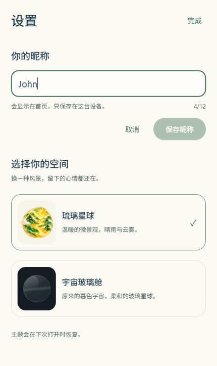

# 设置：修改昵称

2026-10-19。功能与电脑端验证已完成，真实手机键盘和交互待验收。打开 [正式 App](http://localhost:8081/)，在首页点“设置”，找到“你的昵称 → 修改”。

## 使用方式与设计

设置先展示当前昵称，点“修改”再出现输入框、计数、取消和保存。输入沿用首次取名规则：去除首尾空白、最多 12 个 Unicode 码点、不接受空昵称及内部控制字符。未修改、空白或超长时不能保存。按钮和键盘回车共用提交逻辑，防止短时间重复提交。

保存先写入原 `@app/nickname/v1`，成功后才更新全局昵称及首页，不重新挂载导航；失败保留原昵称和输入草稿以便重试。取消或关闭设置丢弃尚未保存的草稿。写入期间暂时禁用关闭和取消，避免离开后才出现无法判断的保存结果。

两个主题共用编辑功能及各自的颜色，输入框焦点采用主题操作色。设置使用键盘避让和可滚动内容；320 像素宽度下仍可见保存、取消按钮。没有增加依赖、心情类型、额外页面或存储字段。

## 修改文件

| 文件 | 原因 |
| --- | --- |
| `App.tsx` | 昵称 Provider 同时覆盖导航和设置，让两处订阅同一个昵称；保留启动读取与首次取名入口。 |
| `src/state/NicknameContext.tsx` | 增加更新昵称的方法；原 `useNickname()` 继续返回字符串，已有首页组件无需改动。 |
| `src/components/NicknameEditor.tsx` | 设置内的编辑、校验、取消、保存及反馈，草稿与已保存昵称分开。 |
| `src/components/ThemeSettings.tsx` | 嵌入编辑区，关闭后丢弃草稿，写入时禁止关闭，并支持键盘避让与滚动。 |
| `src/storage/nicknameStorage.test.cjs` | 增加修改昵称的回归测试：写入失败/无效修改保持旧值，成功修改仅替换昵称键。 |
| `README.md`、本目录 | 当前状态、截图、验证证据与真机边界。 |

## 验证结果

- 74 项自动化测试及类型检查通过；最终 Web 和 Android JavaScript 导出成功，位于 `.codex-tmp/nickname-settings-web` 和 `.codex-tmp/nickname-settings-android`。
- 隔离预览 `127.0.0.1:8082`：未修改、纯空格、13 字符均禁用保存，12 个单码点 emoji 可保存，13 个不可保存。昵称前后空格在写入时去除。
- 确认取消及关闭设置不会保存草稿；成功保存后首页立即显示新昵称，刷新恢复。宇宙玻璃舱主题下回车也能保存，然后通过界面恢复原测试昵称与琉璃主题。
- 320 × 640 时无横向溢出；输入高 52 像素，取消和保存高 44 像素，位于可见区域。小屏主题选项可以向下滚动。窗口恢复后有一次自动点击未生效，重新读取界面后再次检查导航通过，未据此宣称设备手势已完成验收。
- 历史隔离记录仍为 4 天，今天平静、首次记录 10:03。存储测试同时确认主题和心情内容不随昵称更新改变；失败写入保留旧昵称。浏览器未人为注入磁盘故障，存储失败及重试由自动化测试和代码分支覆盖。
- 新隔离来源 `127.0.0.1:8084` 从首次取名进入首页，再通过设置改名；刷新后恢复新名字，仍显示尚未记录心情，未产生默认记录。首次流程和正式预览收集的警告/错误为空。
- 正式预览保留昵称 John，仅查看和取消编辑，未写入昵称、心情或主题。最终设置入口及编辑截图来自正式预览。

过程证据位于 `.codex-tmp/nickname-settings-qa`：`checks.json`、`first-launch.json`、`formal.json` 与各主题、尺寸截图。截图接口可能滞后，正式交付图片在操作完成后的独立调用中重新采集。

未验证：Android 软件键盘遮挡、中文输入法组合输入、实体返回键、原生存储和进程重启；Android JS 导出不等于 APK 或真机验收。本轮没有构建 APK。

## Plan 状态

1. 已完成：核对昵称 Provider 范围、原校验及存储。
2. 已完成：设置编辑、保存与取消，复用存储规则。
3. 已完成：数据保留、首次取名、刷新、两主题、窄屏、双端导出及正式预览。
4. 待用户体验：设置编辑与提示的使用感受。
5. 未开始：Android 真机验收；建议下一阶段先检查键盘、返回键、重启存储及转场表现。
