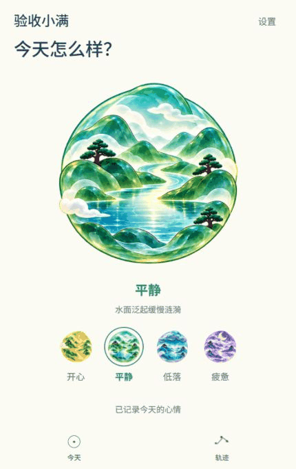
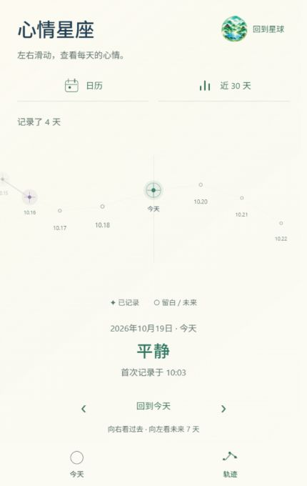

# 3A 修订：后退展开

后续更新：[3B 四页美术与陪伴文案](../art-stage-3b/README.md) 已完成代码与电脑端检查，新的背景和文字配色沿用本目录的转场路径；以下保留 3A 的原始验收记录。

2026-10-19。代码与电脑端检查完成，镜头效果与节奏待用户体验。本轮仅替换“今天 ↔ 轨迹”的琉璃主题转场，3B、3C 尚未开始。

## 体验

[打开正式预览](http://localhost:8081/)。在今天页的设置选择“琉璃星球”，再点击底部轨迹；通过右上角“回到星球”或底部今天返回。已保存的主题偏好不会被强制更换。

星球保持原朝向，逐渐缩小、移向右上角，最后作为“回到星球”入口旁的小标记；星座由稍小的景别展开，页面文字在路径中点交接。返程读取同一路径。单次镜头约 800 毫秒，取消原先的大幅放大、透视倾斜及扫过画面的雾层。星球始终可见，不用大段空白过场衔接页面。

这是现有二维素材的缩放与位移，不包含新增三维模型。原玻璃舱保持原镜头；日期、记录、心情选项和存储逻辑不变，没有新增依赖或切换开关。

下方为隔离预览 430 × 680 的实际截图序列，使用测试昵称及记录，按采集间隔拼接；截图采样率有限，不作为帧率测试：

## 修改文件与理由

| 文件 | 修改与理由 |
| --- | --- |
| `src/navigation/LiuliCamera.ts` | 改为单向缩小、持续可见的往返路径；集中返回按钮布局与落点计算，包含安全区偏移。 |
| `src/navigation/LiuliSpaceScene.tsx` | 移除倾斜、旋转和扫屏雾层；保留同一颗星球与轻微背景光色变化。 |
| `src/navigation/SpaceScene.tsx` | 琉璃镜头改为两段各 400 毫秒、较平缓的曲线；原玻璃舱仍为原有速度。 |
| `src/navigation/SpacePage.tsx` | 移除页面透视和侧移，仅淡入淡出，缩短文字交接区。 |
| `src/screens/RecordsScreen.tsx` | 在现有返回按钮中留出 40 × 40 的星球落点；整个按钮可点击，保留文字说明。 |
| `src/components/ConstellationTrail.tsx` | 琉璃主题星座随镜头从稍小的景别展开；稳定后恢复原大小与日期手势。 |
| `src/navigation/LiuliCamera.test.cjs` | 更新路径测试，验证不放大、不隐藏、返回槽位几何与模拟安全区偏移；原其他导航与存储回归保留。 |
| `README.md`、本目录、`docs/space-stage-3a/README.md` | 更新当前方案、实际证据，标明旧绕行样板已被替换。 |

## 验收

- 类型检查与全部 70 项回归测试通过。
- Web 与 Android JavaScript 导出成功，分别位于 `.codex-tmp/space-pullback-web` 与 `.codex-tmp/space-pullback-android`；没有生成 APK。
- 实际录屏与采样中始终为一个星球，未采到两页活动文字同时显示；星球没有中途消失，落位后没有残留遮罩。
- 320 × 640、430 × 680、360 × 800 三种尺寸均复验：小星球与返回按钮预留区域的位置、尺寸误差小于 0.001 像素；返程位置与尺寸同出发前。首页无横向溢出，四个选项和保存反馈在底栏上方。
- 快速点选“轨迹 → 今天”和“轨迹 → 今天 → 轨迹”，均到达最后目标，无残留遮罩。日历、统计仍可进入并固定返回轨迹；星座向前一天浏览正常。
- 隔离预览运行日志中的警告与错误为空。正式记录不用于测试心情写入。
- 正式预览已刷新，并复验当前宇宙玻璃舱的今天与轨迹往返，仍为 5 天记录、原昵称与疲惫心情；保留用户主题偏好。正式预览警告与错误日志也为空。

原始证据：`.codex-tmp/space-pullback-qa/motion.json`、`responsive.json`、`navigation.json`、`date-browse.json`、`runtime-logs.json` 及 `outbound`、`return` 截图目录。

尚未验证：安卓实体返回键、真机帧率与手势、安全区和减少动态设置的设备表现。安全区几何已有逻辑测试，浏览器验证不能代替设备体验。

## Plan 状态

1. 已完成：后退路径、右上角落点及文字衔接替换。
2. 已完成：往返、反向点选、三尺寸、导航与日期浏览检查，实际录屏和双端 JavaScript 导出。
3. 待用户验收：新方案的自然程度与镜头节奏。
4. 未开始：3B 页面美术统一、3C 其余空间衔接及后续真机验收。
