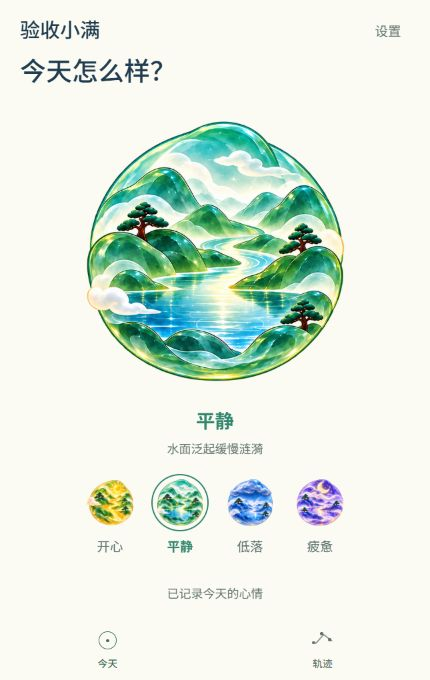
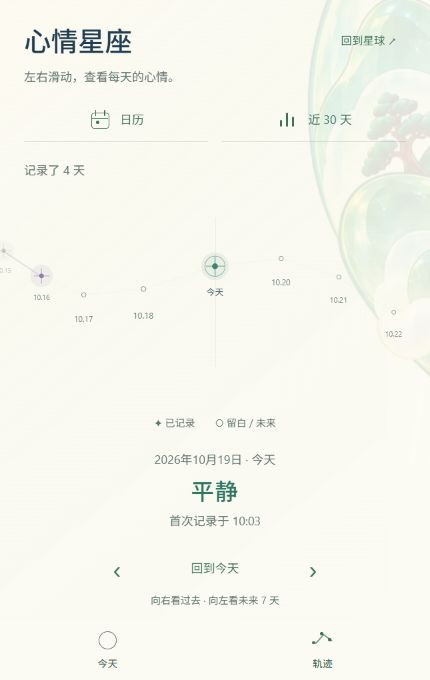

# 3A：今天与轨迹的空间转场样板

当前版本已替换为 [后退展开方案](../space-pullback/README.md)。本目录保留首版靠近绕行的实现说明和录屏，不代表当前预览效果。

2026-10-19。按用户确认的 3A 范围实现；代码与电脑端检查完成，镜头设计、节奏与舒适度待用户体验。3B 页面美术统一、3C 其他页面空间衔接尚未开始。

## 如何体验

[打开正式预览](http://localhost:8081/)。在今天页的设置中选择“琉璃星球”，再切换底部“今天 / 轨迹”。原宇宙玻璃舱继续使用原镜头；不会因代码更新强制覆盖用户已保存的主题。

向轨迹移动时，首页文字先淡出，同一颗星球沿弧线靠近并向右侧绕出；远处光色移动较慢，近处薄雾从镜头前经过；星座内容带轻微透视，从空间中浮现。轨迹边缘保留淡淡的星球轮廓作为位置线索。返回时沿同一条路径逆行，星球回到首页测量的位置。

这是现有分层二维素材的空间样板，使用透视、旋转、缩放和视差，没有新增三维模型，也不能显示星球背面的真实景物。

以下为独立验收预览的实际截图序列，按采集间隔拼接，约 4.6 秒；不是帧率测试或模拟绘制的动画：

## 修改文件与设计原因

| 文件 | 修改与理由 |
| --- | --- |
| `src/navigation/LiuliCamera.ts` | 定义平滑弧线、一次靠近与文字交接区；同一条路径反向读取，减少返程姿态不一致。仅对已定位的今天与轨迹启用动画。 |
| `src/navigation/LiuliSpaceScene.tsx` | 共用星球、远处光色与近处薄雾，三层移动速度不同；装饰场景不进入读屏导航。 |
| `src/components/liuli/LiuliScenePlanet.tsx` | 将现有琉璃、未记录与旧心情画面移到共用位置，保留原四种素材及空状态。 |
| `src/navigation/SpaceScene.tsx` | 将琉璃星球接入原转场控制器、测量失效保护和连续点击队列；保留玻璃舱实现。尺寸变化、后台或减少动态时安全落位。 |
| `src/screens/LiuliTodayScreen.tsx` | 首页留下原尺寸的测量槽位，星球由场景层绘制；选择反馈仍调用原保存逻辑，转场中禁用页面内选择。 |
| `src/navigation/SpacePage.tsx` | 今天与轨迹按镜头进度分段显示文字，带轻微透视位移；转场中阻止页面内部误触，底栏继续可点。 |
| `src/navigation/LiuliCamera.test.cjs` | 新增 3 项路径、文字交接和动画范围测试，覆盖飞行中点回起点的情况。 |
| `README.md`、本目录、`docs/navigation-stage-two/README.md` | 更新当前入口、实现边界与实际验收证据。 |

没有增加依赖、心情类型、设置开关或存储字段；没有修改已确认的星球素材和 92% 显示比例。飞鸟、落雨、水波与浓雾继续使用原动效。跨页保留星球组件，避免离开首页时重新挂载、重播触碰反馈。

## 验收结果

- 类型检查通过，全部 69 项回归测试通过（原 66 项与本轮新增 3 项）。
- 最终 Web、Android JavaScript 导出分别成功写入 `.codex-tmp/space-stage-3a-web` 与 `.codex-tmp/space-stage-3a-android`；未生成 APK。
- 430 × 680 的实际往返采样与截图中，始终只有一个琉璃星球，没有采到两页活动文字重叠；落位后没有转场遮罩。
- 320 × 640、430 × 680、360 × 800 均检查往返与定位：返程的场景位置、尺寸和姿态与出发前一致；无横向溢出，四个心情选项与保存反馈在底栏上方。
- 在轨迹调整尺寸后返回首页，新尺寸完成测量后淡入；定位尚未就绪时直接切换，避免沿过期坐标飞行。
- 快速反向点选最终到达最后选择的轨迹；日历、统计仍能从轨迹进入并固定返回。查看页本轮不增加琉璃镜头。
- 在隔离预览中依次选择开心、低落、疲惫、平静并立即离开、返回：所选心情及已记录提示一致，没有残留旧星球图层，记录天数仍为 4 天；刷新后恢复平静。测试使用 `127.0.0.1:8082` 的独立存储，没有将测试记录写入正式预览。
- 正式预览刷新后复验原宇宙玻璃舱的今天与轨迹往返，仍为 5 天记录；保留当前昵称、疲惫心情和主题偏好。两处预览收集到的浏览器警告与错误均为空。

原始证据位于 `.codex-tmp/space-stage-3a-qa`：`motion.json`、`anchored-responsive.json`、`responsive.json`、`navigation.json`、`mood-journeys.json`、截图目录 `outbound` 与 `return`。屏幕录制的截图采样率有限，不作为流畅帧率证据。

开发过程中热更新曾保留旧导航状态，整页刷新后恢复，本轮已在正式预览执行刷新并复验。若后续开发热更新后页面空白，可先刷新预览；独立导出重新打开的首页正常。

尚未验证：Android 真机帧率、实体返回键、减少动态设置、前后台切换与设备安全区的实际表现。相应的原有控制器安全落位逻辑已有回归测试；浏览器与 JavaScript 打包结果不能代替真机体验。

## Plan 状态

1. 已完成：检查并复用原星球测量与转场控制器。
2. 已完成：共享琉璃星球、弧线往返、分层视差和文字交接。
3. 已完成：类型、逻辑测试、双端导出、电脑预览与实际录屏。
4. 待用户验收：镜头方向、靠近幅度、节奏和轨迹侧边的星球轮廓。
5. 未开始：3B 页面美术统一、3C 其余空间衔接与后续 Android 真机验收。
