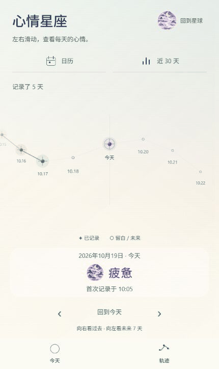
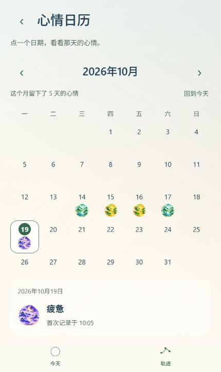
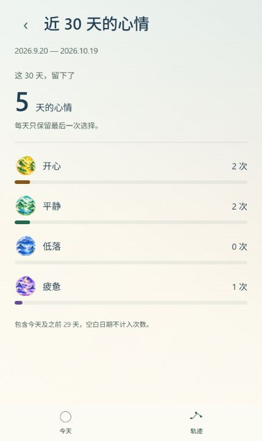

# 3C：日历、统计的进入与返回

2026-10-19。代码及电脑端验证完成，切换节奏待用户体验。打开 [正式预览](http://localhost:8081/)，从“轨迹”进入“日历 / 近 30 天”，左上角返回轨迹；底部“今天”可以直接回首页。

## 本轮行为

琉璃主题中，轨迹与子页用 360 毫秒的淡出、短距离水平移动、淡入连接，位移最大 14 像素，返回时方向相反。文字在中点交接，当前页退出后目标页才出现。固定返回按钮、原月份和选中日期继续保留。

首页与轨迹仍使用此前确认的 800 毫秒后退展开；从子页直接回首页也用 800 毫秒，让星球有时间展开。页面的四站进度与星球的首页/停靠进度分开，日历和统计之间不会拉动星球的缩放。小星球与轨迹标题栏一起淡入、轻移，保持返回按钮内的相对位置。

连续切换仍只保留最后一次意图，正在执行的两段动画使用冻结的起终点和时长，不因后续点击改变速度。减少动态、后台、尺寸改变及截止保护仍能安全落位。旧宇宙玻璃舱保留原空间镜头。

没有新增依赖、素材、页面、心情或存储字段；正式数据未写入测试记录。

## 可查看结果

以下是正式预览中实际浏览器截图拼接的采样动图，包括日历和统计的往返。截图接口有采样及输入延迟，动图不包含每个渲染帧，不能用于判断真实设备帧率或精确动画耗时；代码设定为上述时长。

正式预览截图（John、疲惫、5 天记录，首次创建时间 10:05）：

## 修改文件与理由

| 文件 | 内容 |
| --- | --- |
| `src/navigation/LiuliPageTransition.ts` | 独立的轻滑移曲线和时长选择，主入口与子页使用不同节奏。 |
| `src/navigation/SpacePage.tsx` | 四页统一读取实际起终点，控制淡出/淡入和移动，避免跨过中间页时文字闪现。 |
| `src/navigation/SpaceScene.tsx` | 星球单独的动画进度；星球环境随所属页面淡入、轻移；保留布局测量及中断保护。 |
| `src/navigation/SpaceFlight.ts` | 向两段动画传递同一份实际起终点，排队中的意图不会改写当前镜头。 |
| `src/navigation/LiuliCamera.ts` | 子页不依赖首页定位也能切换；涉及首页的飞行继续要求有效锚点。 |
| `src/navigation/LiuliPageTransition.test.cjs`、`LiuliCamera.test.cjs` | 检查 12 条有向路径无文字重叠、端点复位、返程方向、排队时长与定位门槛。 |
| `README.md`、本目录 | 当前阶段、截图与验证边界。 |

## 验收与边界

- 73 项回归测试、TypeScript 检查通过；最终 Web 与 Android JavaScript 导出成功，位于 `.codex-tmp/space-stage-3c-web`、`.codex-tmp/space-stage-3c-android`。
- 隔离预览检查琉璃与原玻璃舱的轨迹、日历、统计往返；最终版复查子页连续切换、返回首页与返回轨迹，最后一次点击正确落位且解除输入锁。
- 日历查看 9 月后，经轨迹和统计返回日历，月份仍为 9 月；随后用界面“回到今天”恢复。
- 320 × 640 切换途中改变尺寸可安全落位，返回首页后重新测量星球，无横向溢出。恢复默认 430 × 724 时有一次自动点击未生效，重新观察界面后复查通过；没有据此宣称所有尺寸/手势已完成设备验收。
- 实际采样里，子页期间星球缩放保持 40 像素；随轨迹文字轻移时保持相对落点。路径曲线的无重叠由单元测试覆盖，浏览器采样未发现重叠；采样不等同逐帧检查。
- 正式预览刷新后完成“轨迹 → 日历 → 轨迹 → 统计 → 今天”，5 天、疲惫、首次 10:05 在四页一致；正式和隔离预览收集的警告/错误为空。未改写正式心情或主题。
- 原始记录、采样帧和过程检查保存在 `.codex-tmp/space-stage-3c-qa`，其中四份 `proof-*.json` 为最终正式采样及实际时间记录、`initial-captures.json` 为同步小星球位移前的过程证据。演示由前者及其截图生成。

未验证 Android 真机帧率、实体返回键、原生后台与减少动态效果、系统大字号和设备安全区；没有生成 APK。控制器的中断与排队行为有自动化测试，不能替代上述设备验证。

## Plan 状态

1. 已完成：核对原子页瞬切与共用镜头进度的问题。
2. 已完成：轻滑移、文字交接、星球独立进度与同步落点。
3. 已完成：回归测试、双端导出、两主题往返、快速点击、尺寸变化、正式预览和证据。
4. 待用户体验：360 毫秒子页节奏与从子页回首页的整体感受。
5. 未开始：设置中的昵称编辑与 Android 真机验收；建议下一阶段处理。
