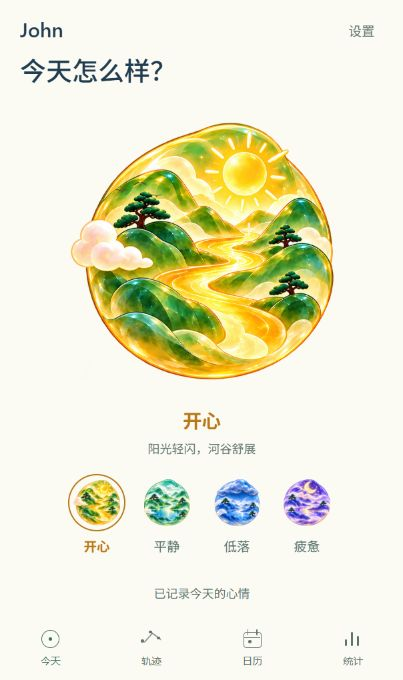
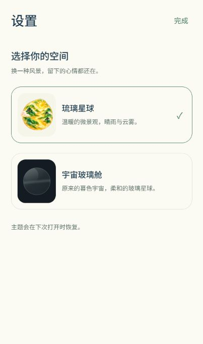

# 阶段一：琉璃首页与主题设置

后续更新（2026-10-19）：[阶段二两入口导航](../navigation-stage-two/README.md) 已完成代码与电脑端验收。以下保留阶段一的原始范围、截图和验证记录，其中四入口导航已被阶段二替换。

2026-10-16。代码与电脑端验收已完成；用户体验与 Android 真机验收待进行。下一阶段的两入口导航尚未实施。

## 体验

- 正式 App：[http://localhost:8081/](http://localhost:8081/)。此入口的心情选择会自动保存。
- 原动效样板：[http://localhost:8081/motion-preview](http://localhost:8081/motion-preview)，继续用于独立比较动效，不保存心情。
- 正式首页右上角“设置”可切换“琉璃星球 / 宇宙玻璃舱”；没有主题偏好时默认琉璃，已保存的偏好会在刷新或重新打开时恢复。

## 本阶段行为

琉璃首页现在共用原有昵称、心情存储与日期逻辑，默认有飞鸟、落雨、水波和浓雾动画，并使用已经确认的 92% 星球显示比例。点选立即更新画面，持久存储完成后显示“已记录今天的心情”；失败时保留本次选择并可重试，读取失败期间不允许新记录覆盖尚未读出的内容。

未记录时显示空星球和“还没记录”，不将默认心情自动写入。两种主题均只有开心、平静、低落、疲惫四个新记录选项。生气、普通、充满动力的旧记录仍按原标签显示，不转换、不删除；更新当天的旧心情时，保留首次创建时间。

主题偏好单独存储在 `@app/theme/v1`，不触碰 `@app/nickname/v1` 和 `@app/mood-records/v1`。主题写入成功后才生效，写入期间禁用重复提交；失败时继续使用原主题，并允许重新点选。损坏或无法读取的偏好显示重试入口，不静默覆盖。

本阶段保留“今天 / 轨迹 / 日历 / 统计”四个入口。琉璃主题的页面先直接切换，新的空间镜头留到后续阶段；原宇宙玻璃舱继续使用原有镜头。其他页面只接入必要的配色、文字可读性与心情图标适配，完整页面美术重构留在阶段三。

## 修改文件及理由

| 文件 | 修改与理由 |
| --- | --- |
| `App.tsx` | 增加主题 Provider、正式主题外壳和设置弹层；保留独立动效样板入口。 |
| `src/state/AppThemeContext.tsx`、`src/storage/themeStorage.ts` | 负责主题读取、写入、错误反馈与设置开关；主题偏好独立于用户记录。 |
| `src/theme/appThemes.ts`、`src/theme/useThemedStyles.ts` | 集中两套基础配色与浅色界面的心情色，供原页面随主题更新。 |
| `src/components/ThemeSettings.tsx` | 轻量设置入口、两种主题预览和持久化反馈；主题选择提供明确的选中语义。 |
| `src/screens/LiuliTodayScreen.tsx` | 将已确认的动效接到真实记录，处理空状态、旧心情、保存状态与重试。 |
| `src/screens/TodayScreen.tsx` | 按主题显示对应首页，保留原玻璃舱实现并增加设置入口。 |
| `src/components/liuli/LiuliMoodButton.tsx`、`src/screens/LiuliMotionPreview.tsx` | 提取共用的软胶选择组件，让正式首页与动效样板保持一致。 |
| `src/components/liuli/LiuliArt.tsx`、`src/components/MoodCelestial.tsx` | 识别四种琉璃心情，让历史页面按主题显示图标，旧类型保留原图形。 |
| `src/models/mood.ts` | 新选择仅保留四种，七种历史类型继续可读取，统一旧记录判断。 |
| `src/navigation/AppNavigator.tsx`、`SpaceScene.tsx`、`SpacePage.tsx` | 接入主题色，区分两套页面环境；主题切回原版时重新测量锚点，避免旧定位闪现；隐藏非当前页的辅助功能内容。 |
| `src/screens/RecordsScreen.tsx`、`CalendarScreen.tsx`、`StatisticsScreen.tsx` | 接入基础主题色与旧记录标识，继续使用原有浏览和统计逻辑。 |
| `src/components/ConstellationTrail.tsx`、`RecordFeedback.tsx` | 调整浅色环境的星位、文字与反馈颜色；星座手势和日期边界沿用原实现。 |
| `src/screens/NicknameScreen.tsx`、`src/state/NicknameContext.tsx` | 首次取名及等待/错误界面跟随主题，保持原校验和保存逻辑。 |
| `src/components/SoftMoodButton.tsx` | 保留原软胶反馈，补齐浏览器选中/禁用语义。 |
| `src/storage/themeStorage.test.cjs`、`MoodPersistence.test.cjs`、`src/models/moodInsights.test.cjs` | 增加主题持久化与数据隔离测试，更新四种可选心情及旧数据计数用例。 |
| `README.md`、本说明 | 区分正式 App 与独立样板，登记范围、检查结果及下一阶段。 |

没有新增依赖，没有更换技术栈，没有实施新导航或真实三维模型。

## 已完成的验收

- 类型检查通过；60 项测试通过，包含主题默认值、两主题恢复、写入失败重试、损坏偏好、昵称与记录不被主题写入改变、旧心情兼容，以及现有日期、存储、星座和镜头回归。
- 独立端口的同份 Web 导出完成首次取名、未记录状态和四种心情选择；连续修改仍只计一天。刷新恢复昵称与最后心情，日历、星座和统计显示相同结果，首次记录时间保留。
- 两主题往返切换并刷新，偏好恢复，看到相同记录；两套主题分别完成三个历史页面与首页的六次往返，结束后只有目标页正文可见且没有残留触摸遮罩。
- 隔离测试数据包含普通、生气、充满动力三条旧记录：新首页显示原标签和“旧记录”，统计总数为三天。将今天的生气更新为疲惫后，日期数量不变，首次时间仍为 06:10，其他历史记录保留。
- 320 × 640、430 × 680、360 × 800 下，正式首页四个选择和固定反馈均在导航上方，设置页面无横向溢出。
- 独立验收环境与主预览均未出现浏览器警告或错误。主预览 John 和当天开心保持原样，未用正式心情按钮进行写入测试。
- Web 导出至 `.codex-tmp/theme-stage-one-web`，Android JavaScript 导出至 `.codex-tmp/theme-stage-one-android`。构建成功不等于生成 APK。

交互测试使用 `http://127.0.0.1:8082/` 的独立存储；旧数据通过仅在该端口开放的测试夹具页面写入。测试夹具不在正式代码中。临时测试页面与服务在验收后关闭。原始截图、交互状态、布局、导航测量和运行日志位于 `.codex-tmp/liuli-motion-qa/theme-stage-one/`。

## 尚未验证与下一步

Android 真机的原生存储恢复、系统返回键、触觉、前后台切换、系统减少动态、大字号和帧率尚未验收；存储失败场景已有逻辑测试，未做设备级故障模拟。本次没有生成 APK。

阶段一的代码与电脑验收完成，等待用户体验。下一阶段按既定方案将底部收敛为“今天 / 轨迹”，日历和统计从轨迹进入；新的空间转场另做样板验收。
